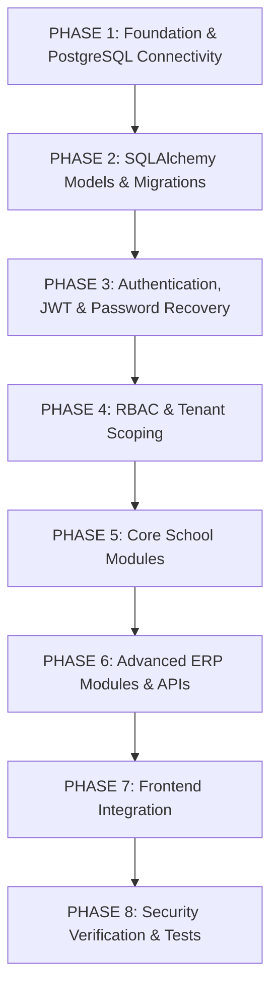

# SCHOOL MANAGEMENT SYSTEM (SMS ERP) — FRONTEND ARCHITECTURAL ANALYSIS & BACKEND SPECIFICATION

> **Analysis Date:** November 2026  
> **Target Version:** 1.0.0 Enterprise Edition  
> **Backend Architecture Decision:** Python Flask, PostgreSQL, SQLAlchemy, Flask-Migrate / Alembic, Flask-JWT-Extended, Argon2, Marshmallow, Flask-SocketIO  
> **Frontend Baseline:** React 19, TypeScript, React Router 7, Vite, Leaflet, Recharts, Responsive Card Design System  
> **Status:** APPROVED BASELINE WITH ARCHITECTURAL CORRECTIONS — ENTERPRISE SPECIFICATION  

---

## 1. EXECUTIVE SYSTEM SUMMARY & ARCHITECTURAL MANDATE

The **School Management System (SMS ERP)** developed by **NTS Novalytix** is a multi-tenant, role-governed educational resource planning platform designed for Indian and international educational boards (CBSE, ICSE, State Board, IB, Cambridge).

### 1.1 Final Technology Stack Decision (No Substitutions)
- **Backend Language & Framework:** Python 3.12+, Flask (Application Factory pattern, Blueprints).
- **Relational Database & ORM:** PostgreSQL (relational integrity, ACID compliance, PostGIS spatial indexing) with **SQLAlchemy 2.0** and **Flask-Migrate / Alembic**.
- **Authentication & Security:** **Flask-JWT-Extended** (15-minute access tokens, 7-day refresh tokens with token rotation, secure HTTP-only cookies), **Argon2** password hashing (`argon2-cffi`), **Flask-Limiter** (login brute-force protection), token revocation blocklist.
- **Serialization & Validation:** **Marshmallow** / `marshmallow-sqlalchemy` schemas for strict request/response data validation.
- **Real-Time Communication:** **Flask-SocketIO** (WebSockets) for live school bus GPS tracking, internal messaging, and real-time push alerts.
- **Documentation & Testing:** Swagger / OpenAPI via Flasgger / APISpec, **Pytest** with high test coverage and isolated fixtures.
- **Production WSGI Server:** **Gunicorn** with eventlet / gevent worker classes for asynchronous WebSocket handling.

*(Note: Node.js, Express, NestJS, Prisma, and Passport.js are explicitly excluded).*

---

## 2. USER ROLES, PERSONAS & PRODUCTION AUTHENTICATION SPECIFICATION

### 2.1 Role Definitions & Configured Seed Personas

| Role Identifier | Role Label | Configured Persona | Email / Identity | Reference ID | Operational Context & Access Scope |
| :--- | :--- | :--- | :--- | :--- | :--- |
| `super_admin` | Super Administrator | Vikramaditya Rao | `superadmin@novalytix.com` | `user-super-admin` | Multi-school network directory, 14-service entitlement switches, tenant suspension, global audit logs, network reports. |
| `school_admin` | School Principal / Admin | Dr. Arvind Swaminathan | `principal@stxaviers.edu.in` | `user-school-admin` (`inst-1`) | Full campus governance: admissions, staff, classes, sessions, promotion engine, fees ledger, confidential question paper review, library delegation. |
| `teacher` | Teaching Faculty | Mrs. Ananya Sharma | `ananya.sharma@stxaviers.edu.in` | `teach-1` (Class 10-A) | Scoped to assigned classes: roll call attendance, homework grading & revision returns, exam marks entry, question paper authoring, staff/class messaging. |
| `teacher` (Dual) | Teacher & Librarian | Mrs. Sunita Verma | `sunita.verma@stxaviers.edu.in` | `teach-5` (Librarian Desk) | Classroom teaching workspace + full circulation desk, accession register, fines, and stock verification. |
| `student` | Enrolled Student | Aarav Patel | `aarav.patel@student.stxaviers.edu.in` | `stud-1` (Class 10-A) | Personal profile, daily 8-period timetable, homework submissions with revision history, report cards, library loans, bus tracking. |
| `parent` | Parent / Guardian | Mr. Vikram Patel | `vikram.patel@gmail.com` | `parent-patel` | Multi-child switcher: ward 360 profile, attendance calendar, online fee settlement via UPI/Card, homework view, live school bus tracker. |
| `supplier` | Vendor / Supplier | Apex Educational Supplies | `orders@apexsupplies.in` | `supp-1` | Purchase order ledger, consignment delivery status updates (`pending` → `delivered`), procurement messaging. |

### 2.2 Production Authentication & Token Lifecycle
1. **JWT Access Tokens:** Short lifespan (15 minutes), containing user ID, role, institution ID, and token jti.
2. **Refresh Tokens:** Long lifespan (7 days), stored in `HttpOnly`, `Secure`, `SameSite=Lax` cookies with strict path restrictions (`/api/v1/auth/refresh`).
3. **Refresh Token Rotation:** Every refresh operation invalidates the old refresh token and issues a fresh token pair; reuse of an invalidated refresh token triggers immediate session revocation.
4. **Token Revocation / Blocklist:** PostgreSQL-backed token blocklist (`token_blocklist`) recording revoked `jti` identifiers with automatic expiry cleanup.
5. **Password Security:** Salted and hashed using **Argon2id** (`argon2-cffi`).
6. **Account Security:** Secure single-use password reset tokens (30-minute expiry), email dispatch simulation/integration, rate limiting on `/api/v1/auth/login` (5 attempts per minute per IP), CSRF protection on mutation endpoints.
7. **Demo Persona Switching:** Controlled strictly via environment flag (`DEV_DEMO_AUTH_ENABLED=True`); strictly rejected with `403 Forbidden` in production.

---

## 3. MULTI-TENANT SECURITY & SCOPING SPECIFICATION

1. **Identity-Derived Tenant Scoping:**
   - The backend MUST NEVER accept `institution_id` from client request bodies or query parameters for school-level operations.
   - All tenant-scoped operations extract `institution_id` directly from verified claims in `get_jwt_identity()` / JWT payload.
2. **Super Admin Exception:**
   - Only users with role `super_admin` are authorized to supply an optional target `institution_id` query parameter to inspect or manage specific tenant data.
3. **Tenant-Scoped Unique Constraints:**
   - Entities such as Admission Numbers (`admission_no`), Class Names (`name`, `grade`, `section`), Staff IDs (`staff_id`), and Route Numbers (`route_number`) have unique constraints scoped to `(institution_id, code/number)`, not globally.
4. **Row-Level Security (RLS):**
   - PostgreSQL Row-Level Security policies can enforce `institution_id = current_setting('app.current_tenant_id')` at the database engine layer as defense-in-depth.

---

## 4. NORMALIZED DATABASE CORRECTIONS & ENTITY ARCHITECTURE

To eliminate monolithic JSONB anti-patterns and enforce relational integrity:

1. **Parent-Student Relationship:** Normalized into `student_parents` association table with relationship type (`Father`, `Mother`, `Guardian`) and primary contact flag, supporting multi-child parents and multiple legal guardians.
2. **Teacher Class-Subject Assignment:** Normalized into `teacher_class_assignments` (`teacher_id`, `class_id`, `subject`, `academic_year`), enabling precise subject-teacher scoping.
3. **Teacher-Librarian Dual Role:** Modelled in `library_staff_assignments` (`teacher_id`, `role_title`, `status`, `assigned_date`), separating classroom teaching from library governance.
4. **Historical Student Enrollments:** Modelled in `student_enrollments` (`student_id`, `session_id`, `class_id`, `roll_no`, `status`), preserving immutable multi-year academic progression history.
5. **Financial Ledger Separation:** Strict segregation between `fee_invoices` (billing demand), `fee_invoice_items` (itemized lines), `fee_payments` (collected receipts), and `payment_transactions` (gateway/counter audit logs).
6. **Immutable Question Paper History:** `question_papers` linked to immutable child tables `question_paper_versions`, `question_paper_reviews`, and `question_paper_audits`.
7. **Cross-Institution Suppliers:** `suppliers` master table mapped to institutions via `supplier_institutions`, allowing established vendors to serve multiple schools with separate purchase orders (`purchase_orders`).
8. **Audit Trail Engine:** Dedicated `audit_logs` table tracking actor, role, institution, entity type, entity ID, action, diff details, IP address, and timestamp.

---

## 5. COMPLETE ROUTE & ACCESS CONTROL MATRIX

| URL Route | Primary Components | Required Role(s) | Service Entitlement Key | Description |
| :--- | :--- | :--- | :--- | :--- |
| `/login` | `LoginPage` | Public | None | Workspace authentication, persona login modal, weather widget. |
| `/` | `DashboardRouter` | All Authenticated | Core / Dynamic | Role-based dashboard dispatching or marketing redirect. |
| `/admissions` | `AdmissionsPage` | `school_admin` | `admissions` | Full 7-tab admission pipeline: inquiries, follow-ups, applications, docs, assessment, offers, capacity. |
| `/students` | `StudentsPage` | `school_admin`, `teacher`, `parent`, `student` | None | Student directory, 360 profile view (academics, attendance, exams, fees, commute). Scoped by role. |
| `/teachers` | `TeachersPage` | `school_admin` | None | Faculty directory, qualifications, class/subject assignments, staff details. |
| `/classes` | `ClassesPage` | `school_admin`, `teacher` | None | Classrooms, academic sessions, promotion engine, bulk student CSV import, class teacher roster. |
| `/attendance` | `AttendancePage` | `school_admin`, `teacher`, `parent`, `student` | `attendance` | Daily student roll call, staff check-in/out, audit correction workflow, monthly student calendar. |
| `/assignments` | `AssignmentsPage` | `school_admin`, `teacher`, `parent`, `student` | `assignments` | Teacher task creator, submission review queue, grading/revision modal, student submission portal. |
| `/examinations` | `ExaminationsPage` | `school_admin`, `teacher`, `parent`, `student` | `examinations` | Exam cycles, subject timetable schedules, marks entry, CBSE 9-point report cards, grading schemes. |
| `/question-papers` | `TeacherQuestionPapersPage` | `teacher` | `question_papers` | Teacher authoring (ERP editor, PDF upload, Scanned image pages), drafts, versions, submission. |
| `/question-paper-review` | `PrincipalQuestionPaperReviewPage` | `school_admin` | `question_papers` | Confidential Principal review queue, approve/reject/request changes, direct edit, post-finalization amendments. |
| `/fees` | `FeesPage` (`AdminFeePortal`, `ParentFeePortal`) | `school_admin`, `parent`, `student` | `fees` | Fee invoices ledger, itemized fees, counter payment recording, online gateway payment, receipt generation. |
| `/timetable` | `TimetablePage` | `school_admin`, `teacher`, `parent`, `student` | `timetable` | 6-day 8-period weekly timetable, teacher/room conflict detection engine, student class schedule. |
| `/calendar` | `CalendarPage` | `school_admin`, `teacher`, `student` | `calendar` | Campus events, holidays, examinations, PTMs with audience tagging. |
| `/notices` | `NoticesPage` | All except `super_admin` | None | Circulars bulletin board, priority levels, audience filters (`all`, `teachers`, `students`, `parents`, `suppliers`). |
| `/messages` | `MessagesPage` | `school_admin`, `teacher`, `parent`, `supplier` | None | 1-to-1 threaded messaging between campus stakeholders. |
| `/staff-groups` | `StaffGroupsPage` | `school_admin`, `teacher` | `staff_groups` | Collaboration channels (`all_staff`, `role_based`, `department`, `class_based`, `custom`), announcements. |
| `/class-groups` | `ClassGroupsPage` | `school_admin`, `teacher`, `parent`, `student` | None | Classroom announcement hub, homework alerts, exam circulars with read receipts. |
| `/leave` | `LeavePage` | `school_admin`, `teacher`, `parent`, `student` | None | Leave applications (Medical, Casual, etc.), parent applying for ward, admin review/approval modal. |
| `/library` | `LibraryManagementPage` | `school_admin`, `teacher`, `student` | `library` | Catalogue, accession registry (`LIB-2026-XXXX`), circulation desk (issue/return), fines ledger, stock audit. |
| `/transport` | `TransportPage` | `school_admin`, `parent`, `student` | `transport` | Leaflet live fleet map, route master, daily trips, safety check-in manifest (QR/RFID/manual), delay alerts. |
| `/reports` | `ReportsPage` | `school_admin`, `super_admin` | `reports` | Multi-school vs school-scoped analytics: students, fees, attendance, academics, transport, marketing, CSV export. |
| `/service-entitlements` | `ServiceEntitlementsPage` | `super_admin` | None | Package templates, 14 granular service toggles per institution, account suspension, audit logs. |
| `/digital-marketing` | `DigitalMarketingPage` | `school_admin`, `super_admin` | `digital_marketing` | Campaign manager (Google, Meta, Instagram, Local), Principal budget approvals, lead CRM funnel, content calendar. |
| `/academic-awards` | `AcademicAwardsPage` | All Authenticated | None | Student/staff awards registry, achievement levels, competitions, certificates generation, Wall of Fame gallery. |
| `/institutions` | `InstitutionsPage` | `super_admin` | None | Member schools directory, board affiliations, subscription plans, status toggles. |
| `/suppliers` | `SuppliersPage` | `school_admin`, `supplier` | None | Purchase orders, itemized procurement lines, consignment delivery status updates. |
| `/settings` | `SettingsPage` | `school_admin`, `super_admin` | None | Institutional identity profile, CBSE board affiliation, currency, backup export/restore. |
| `/about` | `AboutPage` | `school_admin`, `super_admin` | None | Application version, license, institutional support overview. |

---

## 6. FINANCIAL & REAL-TIME TELEMETRY SECURITY

1. **Payment Gateway Architecture:**
   - Client requests initiation -> Backend generates order with signature -> Client pays on gateway modal -> Gateway sends server-to-server webhook.
   - Backend cryptographically verifies HMAC SHA-256 signature before marking `fee_invoices` and `payment_transactions` as paid.
   - Frontend simulated payments will be replaced with real backend payment verification endpoints.
2. **GPS Telemetry Architecture:**
   - Physical vehicle GPS trackers stream standardized NMEA / AIS-140 packets via TCP/UDP or MQTT to ingestion service.
   - Simulated telemetry is explicitly flagged (`is_simulated = True`) and isolated from production vehicle records.
   - Coordinates are broadcast to parent/admin client sockets via Flask-SocketIO rooms (`route:<route_id>`).

---

## 7. ZERO-FRONTEND-REDESIGN INTEGRATION STRATEGY

1. **Design Preservation Guarantee:**
   - Zero modifications to UI components, layout structures, CSS variables, typography, navigation menus, or component styling.
2. **Service Layer Swap:**
   - Frontend services in `frontend/src/services/` retain exact exported function signatures (`studentService.getAll()`, `feeService.recordPayment()`, `admissionService.enrollApplicant()`).
   - The underlying storage calls to `ERPStorage.get()` / `ERPStorage.set()` will be mapped to backend API calls via a lightweight HTTP client.
   - Window event `nts_erp_storage_updated` will be dispatched upon API responses to maintain real-time reactivity without altering any page components.

---

## 8. BACKEND IMPLEMENTATION ROADMAP

---

*Document approved as technical foundation for Flask + PostgreSQL School ERP backend.*
